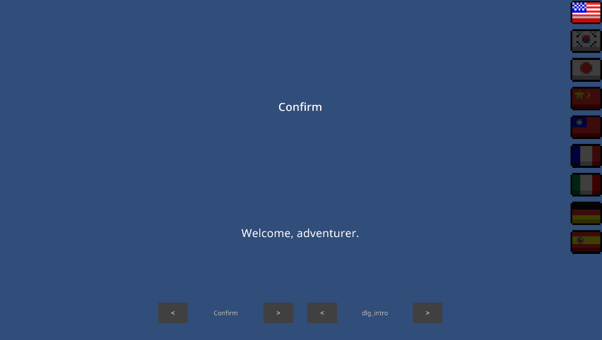
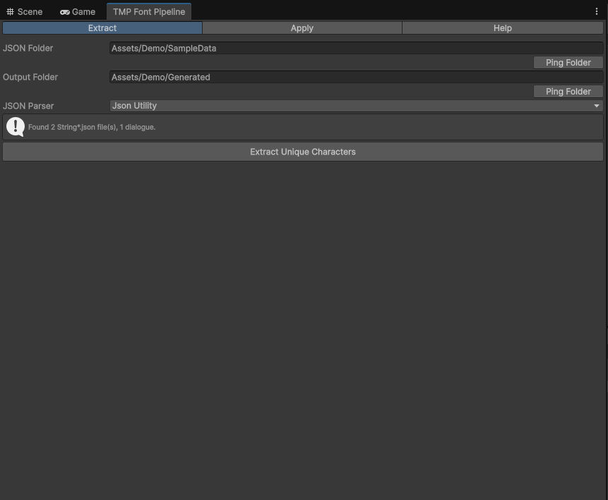
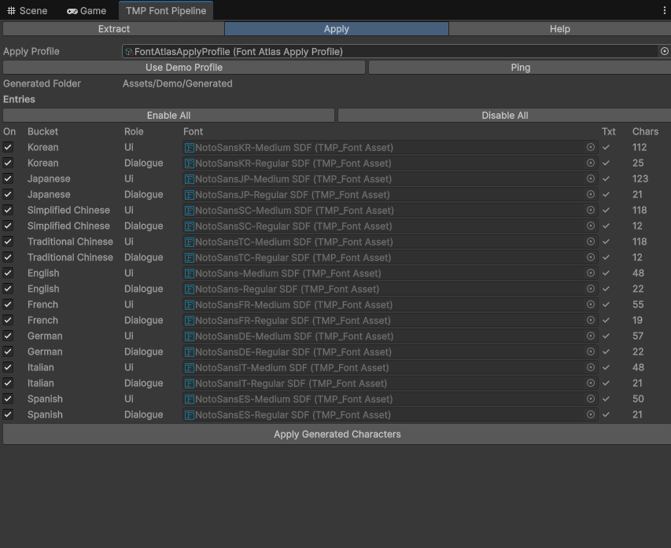
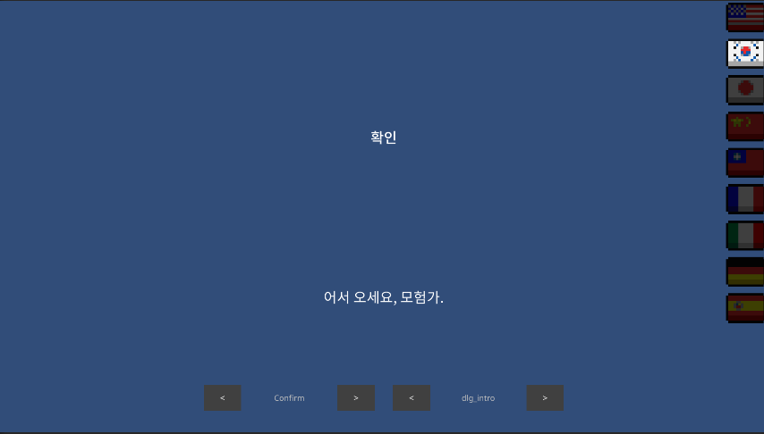
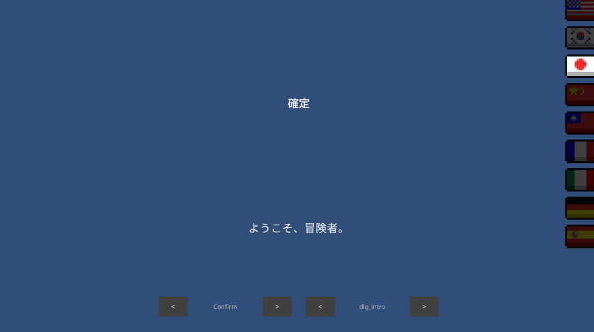

# TMP Font Pipeline

로컬라이즈 JSON에서 고유 글자를 추출하고, 런타임 TMP 폰트 워밍업으로 Dynamic atlas 성장·첫 draw 스파이크를 플레이 밖으로 옮기는 파이프라인이에요.

**구조·Extract → Apply → Warmup** 상세는 [Architecture](docs/architecture/Architecture_TmpFontPipeline.md)가 정본이다. 아래 **불변조건**만 README 계약이다.

**포함**

- **문자 추출** — `String*.json` → `unique_chars_*.txt` (언어 버킷, Ui/Dialogue 분리, sanitize)
- **Static atlas Apply** — Generated txt → Editor Window + `FontAtlasApplyProfile`로 TMP Static SDF bake
- **런타임 warmup** — `FontWarmupService` + `IFontWarmupTarget` (역할별 sample, font 1개당 1프레임)
- **Demo** (선택) — `Assets/Demo` 놀이터: `SampleScene`, 언어 전환, string key picker

설치 단위는 UPM **`Packages/com.monet5379.tmp-font-pipeline`**이에요. `Assets/Demo`는 이 repo 놀이터(비설치)예요.


정본: [`docs/diagrams/pipeline.ko.mmd`](docs/diagrams/pipeline.ko.mmd)



## 요구 사항

- Unity **6000.3** 이상 (`com.monet5379.tmp-font-pipeline` `package.json`)
- **TMP Essentials** — Window → TextMeshPro → Import TMP Essential Resources (Unity 6 · `com.unity.ugui`)
- 패키지 의존: `com.unity.ugui` · `com.unity.nuget.newtonsoft-json` (Editor Newtonsoft 파서 모드)

## 설치

### Git URL (권장)

Package Manager → **Install package from git URL**:

```text
https://github.com/monet5379/unity-tmp-font.git?path=/Packages/com.monet5379.tmp-font-pipeline#v0.1.1
```

### 로컬 임베디드

`Packages/com.monet5379.tmp-font-pipeline`를 소비 프로젝트 `Packages/` 아래에 두거나, 이 repo처럼 `Packages/manifest.json`에 `file:com.monet5379.tmp-font-pipeline`로 참조해요.

패키지 README·CHANGELOG: [`Packages/com.monet5379.tmp-font-pipeline/README.md`](Packages/com.monet5379.tmp-font-pipeline/README.md).

> [!NOTE]
> **이 repo에서 확인 (선택)**
>
> - **개발용 repo:** `Assets/Demo` 놀이터만 써요. Package Manager에서 **Demo** 샘플 **Import는 하지 않아요** (Import한 샘플 JSON과 Demo `SampleData`가 겹치면 Extract 입력이 헷갈려요). 배포용 슬림 예시 정본은 `Samples~/Demo`이며, 소비 프로젝트는 [패키지 README — Samples](Packages/com.monet5379.tmp-font-pipeline/README.md#samples)를 따른다.
> - Unity로 **repo 루트**를 연다 → `Assets/Demo/Scenes/SampleScene` Play → 국기 버튼·key picker로 warmup·라벨을 확인해요.
> - `Assets/Demo`는 **패키지·설치 대상이 아니에요.** Demo 스크립트는 **`TmpFontPipeline.Runtime`** (`Packages/.../Runtime/TmpFontPipeline.Runtime.asmdef`)을 참조하는 asmdef 아래에 있어요.
> - Extract JSON/출력 폴더·Apply Active Profile은 창·`EditorPrefs`·프로필 에셋으로 **직접 지정**해요. 패키지에 Demo 기본 경로는 없어요.

기본 Extract 파서는 Unity `JsonUtility`예요. 불규칙 JSON은 창에서 **Newtonsoft** 모드를 쓰세요.

## 불변조건

- 문자셋 SSOT = 추출된 Static atlas (`unique_chars_*.txt` → TMP Character Table). 워밍업 sample text가 아니에요.
- Warmup은 **언제** 처음 그리는지를 담당해요. 전 glyph 보장은 하지 않아요.
- Warmup **sample text는 역할별**이에요 — Ui는 UI 버킷 문자열(예: `Confirm`), Dialogue는 dialogue 버킷(예: `dlg_intro`). sample은 대상 Static atlas와 **같은 추출 버킷**에서 고르세요.
- 추출 전 sanitize로 TMP 태그·placeholder·토큰을 제거해요 — JSON 원문을 그대로 아틀라스에 넣지 않아요. **런타임 표시**(Demo `DemoStringTable`)는 JSON 필드를 그대로 읽어요 — 화면용 문장은 JSON에 완성형으로 두세요(런타임 `[token]` 치환 없음).
- UI·Dialogue 버킷을 분리해, 대화 전용 CJK가 UI 폰트 atlas를 불필요하게 키우지 않아요.
- **Font usage role:** `Ui` = 인게임 공용(Demo Medium), `Dialogue` = 대화(Regular). weight enum이 아니라 어떤 Static asset에 어떤 extract 버킷을 넣을지 구분해요.
- 유럽어 **기본**은 언어별 분리예요 (`English` … `Spanish`) — Ui/Dialogue 각각 `unique_chars_<Language>.txt` / `unique_chars_<Language>_StringDialogue.txt`.
- **선택:** Extract 탭 **European Extract → MergedEuropean**이면 CJK는 그대로 언어별이고, 유럽 5개 필드는 버킷(Ui / Dialogue)마다 `unique_chars_European.txt` / `unique_chars_European_StringDialogue.txt` 합집합만 써요. Apply 프로필은 `FontAtlasBucket.European` + 역할(Ui/Dialogue)로 같은 txt를 여러 `TMP_FontAsset`에 매핑할 수 있어요.
- 간체 중국어 필드명은 **`SimplifiedChinese`** (정식 철자)예요.

Sanitize 제거 대상: TMP style/color/bold/italic/size 태그, `<sprite…>`, `{0}` placeholder, `[token]`, 제어·레이아웃 코드포인트.

Ui 버킷(`unique_chars_<Language>.txt`, Dialogue 접미사 없음) 추출 txt와 Apply bake 시 JSON에 없어도 **`_`** 를 charset에 포함해요. Dialogue 버킷 txt에는 Extract 단계에서 넣지 않고, Apply 시에만 merge해요.

`Assets/Demo/Fonts/Dynamic/`은 이 추출의 대상이 **아니에요**. 예측 불가 문자열(리더보드 닉네임 등)에만 Dynamic을 쓰세요.

## 이 패키지가 아닌 것

- 출시용 로컬라이즈·Font Asset 전체 템플릿 (`Assets/Demo`는 놀이터)
- Dynamic atlas를 Static 추출 파이프라인으로 다루는 것
- 런타임 `[token]` 치환·문자열 테이블 시스템 (표시용 문장은 JSON에 완성본으로)

## Editor — 문자 추출



**Tmp Font Pipeline → Open Window** → **Extract** 탭.

1. **JSON Folder** · **Output Folder** 지정 (값은 `EditorPrefs`에 저장. 비어 있으면 빈 칸).
2. 파서(`JsonUtility` 기본, 불규칙 JSON은 `Newtonsoft`) · **European Extract**(`PerLanguage` 기본, 공용 SDF면 `MergedEuropean`) 설정.
3. **Extract Unique Characters**. `String*.json` 수정 후에는 **Extract를 다시** 실행해 Generated txt와 맞추세요.
   - **이 repo 예:** JSON `Assets/Demo/SampleData`, 출력 `Assets/Demo/Generated` (`unique_chars_*.txt`)

| 출력 | 소스 |
|------|------|
| `unique_chars_Korean.txt` 등 | UI / non-dialogue `String*.json` |
| `unique_chars_*_StringDialogue.txt` | `StringDialogue*` 파일 |
| `unique_chars_English.txt` | `English` 필드 (`String*.json`) |
| `unique_chars_French.txt` | `French` 필드 (`String*.json`) |
| `unique_chars_German.txt` | `German` 필드 (`String*.json`) |
| `unique_chars_Italian.txt` | `Italian` 필드 (`String*.json`) |
| `unique_chars_Spanish.txt` | `Spanish` 필드 (`String*.json`) |
| `unique_chars_European.txt` | **MergedEuropean** — `English`+`French`+`German`+`Italian`+`Spanish` (Ui 버킷) |
| `unique_chars_European_StringDialogue.txt` | **MergedEuropean** — 동일 5필드 (Dialogue 버킷) |

## Editor — Static atlas Apply



같은 창 → **Apply** 탭.

1. **Font Atlas Apply Profile** 지정, 엔트리 **Enabled** 토글(또는 **Enable All** / **Disable All**).
2. **Apply Generated Characters**.
   - **Ping**은 Project 창에서 프로필 에셋을 하이라이트해요.
   - Apply 시 대상 atlas 크기를 `2048x2048`로 맞춘 뒤 bake해요.
3. 대상 Font Asset의 Atlas Population Mode = **Static** 확인.

**Help** 탭은 Extract → Apply 단계 요약만 보여줘요 (Demo 시드 버튼 없음).

**이 repo — Demo 시드** (`Assets/Demo/Editor/DemoFontProfileBootstrap`):

메뉴 **Tmp Font Pipeline → Font Atlas Apply Profile → Create Demo Assets** — `Assets/Demo`에 `FontAtlasApplyProfile` + `FontRoleCatalog` 생성·시드, Active Profile 설정. 프로필이 이미 있으면 demo 바인딩으로 **덮어씀** (`Enabled` 전부 true). 유럽 분리 이전 프로필이면 같은 메뉴를 다시 실행(재시드)하세요.

Demo 매핑 (Create Demo Assets 후):

| Bucket | Role | Demo Static asset |
|--------|------|-------------------|
| Korean (etc.) | Ui | `*/NotoSans*-Medium SDF` |
| Korean (etc.) | Dialogue | `*/NotoSans*-Regular SDF` |
| English/French/German/Italian/Spanish | Ui | `EN/FR/DE/IT/ES/*-Medium SDF` |
| English/French/German/Italian/Spanish | Dialogue | `EN/FR/DE/IT/ES/*-Regular SDF` |

## Runtime — 폰트 조회

**Font Role Catalog** (`Assets → Create → Tmp Font Pipeline → Font Role Catalog`) — `LanguageId` + `Ui` / `Dialogue` → `TMP_FontAsset`.

이 repo에서는 **Create Demo Assets** 메뉴로 `Assets/Demo`에 catalog가 시드돼요. 소비 프로젝트는 자기 `FontRoleCatalog`를 만든다.

## Runtime — 폰트 warmup

`IFontWarmupTarget`을 **게임·Demo 코드**에서 구현해요. 부팅·언어 변경 시 `FontWarmupService.RequestWarmup`을 호출하세요.

Ui·Dialogue Static atlas는 **서로 다른 추출 버킷**(`unique_chars_*.txt` vs `unique_chars_*_StringDialogue.txt`)이에요. 숨김 warmup 텍스트가 atlas에 없는 글자를 참조하지 않도록 **역할별** sample을 넘기세요.

| Role | Demo sample 출처 | 예 (KO) |
|------|------------------|---------|
| `Ui` | `StringUI` → `Confirm` | `확인` |
| `Dialogue` | `StringDialogue` → `dlg_intro` | `어서 오세요, 모험가.` |

`FontWarmupSampleText.GetForLanguage(languageId, role)`는 Demo JSON 키와 맞춘 **편의 기본값**이에요. 게임 문자열이 다르면 `GetSampleText`를 override하되, 각 sample은 해당 role의 추출 charset 안에 두세요.

```csharp
using TmpFontPipeline;

public sealed class MyFontWarmupTarget : IFontWarmupTarget
{
    public IReadOnlyList<TMP_FontAsset> GetFontsForWarmup(string languageId) { /* ... */ }
    public TMP_FontAsset GetFontForWarmup(string languageId, FontUsageRole role) { /* ... */ }
    public string GetSampleText(string languageId, FontUsageRole role) =>
        FontWarmupSampleText.GetForLanguage(languageId, role);
    public void PreloadSpriteAssets(string languageId) { }
}
```

`FontWarmupService`는 **Ui → Dialogue** 순, font 1개당 1프레임이에요. supersede 시 `onSuperseded`가 호출돼요. warmup 중 input block은 호출 측 책임이에요(Demo 참고).

## Demo (선택)

놀이터 전용이에요. 출시용 로컬라이즈·Font Asset 템플릿이 아니에요.

1. **Tmp Font Pipeline → Font Atlas Apply Profile → Create Demo Assets** (1회).
2. **Extract** 후 **Apply** — Static SDF가 `Assets/Demo/Generated/`와 일치하는지 확인.
3. **`Assets/Demo/Scenes/SampleScene.unity`** 열고 Play.

| 오브젝트 | 스크립트 | 역할 |
|----------|----------|------|
| `FontWarmup` | `DemoFontWarmupBootstrap` | `IFontWarmupTarget` + `FontWarmupService` 보장 |
| `FontWarmup` | `DemoLanguageSwitcher` | 부팅 `EN` → input block → `RequestWarmup` → 라벨 갱신 → unblock |
| `UiLabel` / `DialogueLabel` | `DemoLocalizedLabel` | role + string key → warmup 후 font·text |

국기 버튼 9개: `EN`, `KO`, `JP`, `SC`, `TC`, `FR`, `DE`, `IT`, `ES`. 라벨은 `Confirm`(Ui / Medium), `dlg_intro`(Dialogue / Regular). 대화 샘플 키: `dlg_intro`(예: KO `어서 오세요, 모험가.`), `dlg_boss`(예: KO `드래곤이 모험가를 부르고 있다!`) — 데이터 토큰 없이 완성 문장만.

**String key picker** (`DemoStringKeyPicker`, `_enableKeyPicker` 켜면 자동 추가): **UI ◀ ▶** / **Dlg ◀ ▶**로 extract된 키만 순환해요. 키 목록은 `DemoStringKeyPicker._uiKeys` / `_dialogueKeys`. 키 변경은 `SetLabelKey` + `RefreshAllLabels`만(warmup 없음).

국기 버튼으로 언어를 바꿔 CJK 예시를 확인할 수 있어요.





데모 폰트 라이선스: [LICENSE-AND-CREDITS.md](Assets/Demo/Fonts/LICENSE-AND-CREDITS.md).

## 관련

- [TMP Static 폰트 아틀라스](https://monet5379.github.io/notes/tmp-static-font-atlas/) — 설계 배경 (Dragon 맥락)
- [TMP 폰트 워밍업](https://monet5379.github.io/notes/tmp-font-warmup/) — warmup vs Static SSOT
- [TMP Font Pipeline (사이트)](https://monet5379.github.io/projects/tmp-font-pipeline/) — 포트폴리오 개요

## Architecture

- [Architecture_TmpFontPipeline](docs/architecture/Architecture_TmpFontPipeline.md) — asmdef · Extract → Apply → Warmup · Demo vs Samples~

## 라이선스

[MIT](LICENSE)

---

README 본문은 AI-assisted로 작성·갱신했으며, 계약·코드와 충돌하면 **코드·Architecture**가 우선이다.
