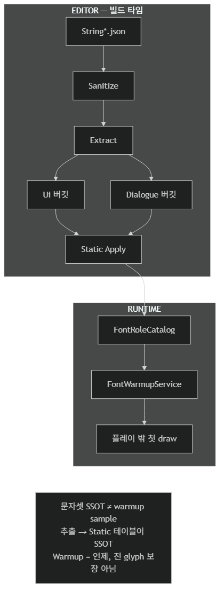
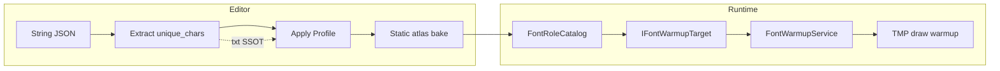

# Architecture: TmpFontPipeline

## 개요 (Overview)

*로컬라이즈 JSON에서 **고유 글자**를 추출해 Static TMP atlas의 SSOT로 쓰고, 런타임 warmup으로 **언제** 처음 그릴지만 플레이 밖으로 옮긴다.*

TMP Font Pipeline은 `Packages/com.monet5379.tmp-font-pipeline/` UPM 패키지이다. Editor에서 Extract → Apply, Runtime에서 `FontWarmupService` + `IFontWarmupTarget`이 게임과 연결된다.

**계약(불변조건) 정본**은 [루트 README](../../README.md)이다. 이 문서는 asmdef 경계·Extract → Apply → Warmup 흐름·Demo vs Samples만 다룬다.

다이어그램 소스: [`docs/diagrams/pipeline.ko.mmd`](../diagrams/pipeline.ko.mmd)

## 책임과 경계 (Responsibilities & Boundaries)

### 포함 범위 (In Scope)

- **Extract:** `String*.json` → sanitize → 언어·Ui/Dialogue 버킷별 `unique_chars_*.txt`
- **Apply:** Generated txt → `FontAtlasApplyProfile` 엔트리 → Static `TMP_FontAsset` Character Table bake (Editor Window)
- **Warmup:** 역할별 sample text로 숨김 draw — **전 glyph 보장 아님**
- UPM `Samples~/Demo` — JSON 예시 · `IFontWarmupTarget` 스크립트 (Import용)
- 이 repo `Assets/Demo` — 씬·폰트·Generated·부트스트랩 (**설치·복사 대상 아님**)

### 제외 범위 (Out of Scope)

- Dynamic atlas를 Static 추출 파이프라인으로 다루는 것
- 런타임 `[token]` 치환·문자열 테이블 시스템
- 출시용 로컬라이즈·Font Asset 전체 템플릿 (`Assets/Demo`는 놀이터)
- 상세: [루트 README — 이 패키지가 아닌 것](../../README.md#이-패키지가-아닌-것)

## 주요 타입과 관계 (Key Types & Relationships)

| 트리 | asmdef | 역할 |
| --- | --- | --- |
| `Packages/.../Runtime/` | `TmpFontPipeline.Runtime` | `FontWarmupService`, `IFontWarmupTarget`, `FontRoleCatalog`, `FontAtlasApplyProfile`, `FontWarmupSampleText` |
| `Packages/.../Editor/` | `TmpFontPipeline.Editor` | `TmpFontPipelineWindow`, Extract/Apply, JSON 파서, `FontAtlasApplier` |
| `Packages/.../Samples~/Demo/` | `TmpFontPipeline.Sample.Demo` | 예시 JSON · `SampleFontWarmupTarget` — Package Manager **Import** |
| `Assets/Demo/` | `TmpFontPipeline.Demo` · `TmpFontPipeline.Demo.Editor` | `SampleScene`, Noto SDF, Generated, `DemoFontProfileBootstrap` — **비설치** · 이 repo에서는 샘플 **Import 안 함** |
| `Assets/TextMesh Pro/` | (기본 어셈블리) | 개발 repo TMP Essentials — **패키지 밖** |

| 타입 | 레이어 | 책임 |
| --- | --- | --- |
| `StringJsonCharacterExtractor` | Editor | JSON 폴더 스can → 버킷별 unique chars txt |
| `FontAtlasApplyProfile` | Runtime (SO) | Generated 폴더 경로 · bucket/role/font/enabled 엔트리 |
| `FontAtlasApplier` | Editor | Enabled 엔트리에 txt 내용을 Static atlas에 bake |
| `FontRoleCatalog` | Runtime (SO) | `languageId` + `FontUsageRole` → `TMP_FontAsset` |
| `FontWarmupService` | Runtime | `RequestWarmup` — Ui → Dialogue, supersede, 1 font/frame |
| `IFontWarmupTarget` | Runtime (소비자) | warmup 대상 font · 역할별 sample text |

## 흐름 (Flow)

### Extract (Editor)

1. **Tmp Font Pipeline → Open Window → Extract**에서 JSON Folder · Output Folder 지정 (`EditorPrefs` persist).
2. **Extract Unique Characters** — `String*.json` / `StringDialogue*` 스can, sanitize, 언어·Ui/Dialogue 버킷별 `unique_chars_*.txt` 출력.
3. 문자셋 **SSOT** = 이 txt → Apply 후 TMP Character Table. Warmup sample text는 SSOT가 아니다.

### Apply (Editor)

1. 소비자가 `FontAtlasApplyProfile` 생성 (`_generatedFolder` = Generated txt가 있는 프로젝트 경로).
2. Apply 탭에서 Active Profile 지정 (`FontAtlasApplySettings.ActiveProfilePath`), 엔트리 **Enabled** 선택.
3. **Apply Generated Characters** — 대상 Static font atlas 2048, Population Mode **Static** 전제.

### Warmup (Runtime)

1. 게임(또는 Demo)이 `IFontWarmupTarget` 구현 — catalog에서 font, 역할별 sample 반환.
2. 부팅·언어 변경 등에서 `FontWarmupService.RequestWarmup(target, languageId, …)`.
3. Ui → Dialogue 순, font 1개당 1프레임. supersede 시 `onSuperseded`. input block은 호출 측.

## Demo vs Samples~

| | `Samples~/Demo` (UPM Import) | `Assets/Demo` (이 repo만) |
| --- | --- | --- |
| 목적 | 소비 프로젝트에 JSON·스크립트 예시 복사 | 전체 놀이터 (씬·폰트·Generated·SDF) |
| Create Demo Assets | 없음 | `DemoFontProfileBootstrap` — 메뉴 **Tmp Font Pipeline → Font Atlas Apply Profile → Create Demo Assets** |
| Extract 기본 경로 | Import 후 사용자 지정 | `Assets/Demo/SampleData` → `Assets/Demo/Generated` (창에서 설정) |
| Package Manager Import | 소비자 권장 | **개발 repo는 Import하지 않음** ([README NOTE](../../README.md)) |

## 불변조건과 주의점 (Invariants & Gotchas)

*README 계약을 구현 관점에서 풀어 쓴다. 문구 충돌 시 [루트 README](../../README.md)가 이긴다.*

- **Charset SSOT:** 추출 txt → Static atlas. Warmup sample은 “언제 그릴지”만 — missing glyph 방지는 sample이 해당 버킷 charset 안에 있어야 한다.
- **Ui / Dialogue 버킷 분리:** `unique_chars_*` vs `unique_chars_*_StringDialogue` — role별 sample은 **같은 추출 버킷**에서 고른다.
- **European Extract:** 기본 `PerLanguage` per-field txt. `MergedEuropean`(EditorPrefs)은 CJK 개별 + `unique_chars_European*` 합집합; Apply는 `FontAtlasBucket.European`.
- **Sanitize:** Extract 전 TMP 태그·placeholder·`[token]` 제거. **런타임 표시**는 JSON 필드 그대로 (완성 문장 SSOT).
- **Mandatory glyph:** Ui 버킷 Extract txt + Apply bake 시 `FontAtlasMandatoryCharacters`(`_`만). Dialogue Extract txt에는 주입하지 않음 — Apply는 txt 읽기 후 merge.
- **Apply duplicate font:** Enabled 엔트리에서 동일 `TMP_FontAsset` 경로가 반복되면 경고(`FontAtlasApplyDuplicateWarnings`). Bucket/Role 중복만으로는 경고하지 않음 (European 등 동일 txt → 여러 SDF).
- **`FontWarmupSampleText`:** Runtime 편의 상수 — Demo JSON과 맞춘 기본값이지, 모든 게임의 SSOT가 아니다.
- **패키지 경로 비의존:** Editor 기본 Demo 폴더·Apply Demo 프로필 폴백 없음.

## 변경 가이드 (Change Guidelines)

| 변경 | 확인할 경로 |
| --- | --- |
| Extract 버킷·sanitize·mandatory glyph·European mode | `StringJsonCharacterExtractor`, `EuropeanExtractSettings`, `FontAtlasMandatoryCharacters`, `StringTextSanitizer`, README 출력 표 |
| Apply bake 규칙 | `FontAtlasApplier`, `FontAtlasApplyDuplicateWarnings`, Window Apply 탭 |
| Warmup 스케줄 | `FontWarmupService`, `IFontWarmupTarget` |
| Demo 시드 | `Assets/Demo/Editor/DemoFontProfileBootstrap` (패키지 밖) |
| Samples | `Samples~/Demo` JSON·`SampleFontWarmupTarget` |
| public API · asmdef 이름 | README 불변조건 · 이 문서 표 |

구조·경계·public API·파이프라인 흐름을 바꾸면 이 파일을 갱신한다. 불변조건 문구가 바뀌면 **README를 먼저** 고친다.

## 관련 문서 (See also)

- [패키지 README](../../Packages/com.monet5379.tmp-font-pipeline/README.md) — 설치 · Samples · Editor 진입
- [TMP Static 폰트 아틀라스](https://monet5379.github.io/notes/tmp-static-font-atlas/) · [TMP 폰트 워밍업](https://monet5379.github.io/notes/tmp-font-warmup/)
- [unity-studio-kit — Documentation (Architecture)](https://github.com/monet5379/unity-studio-kit/blob/main/docs/game/Documentation.md#architecture-작성-규약)
